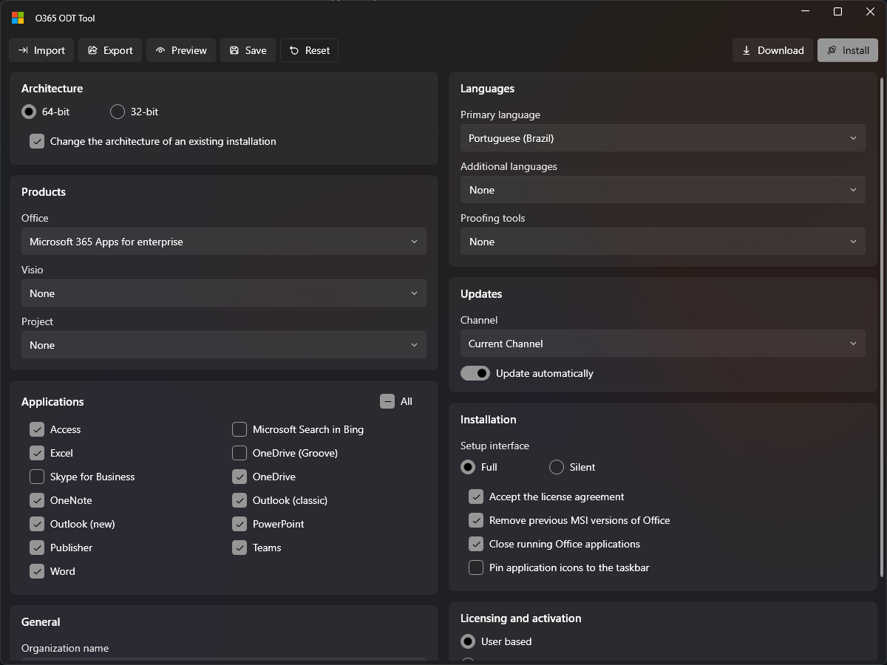

# O365-ODT-Tool

A small Windows app to configure, download, and install Microsoft 365 Apps with the [Office Deployment Tool](https://learn.microsoft.com/microsoft-365-apps/deploy/overview-office-deployment-tool) (ODT), all from a single form. It replaces the manual routine of building a configuration on the [Office Customization Tool](https://config.office.com/deploymentsettings), saving the XML, fetching `setup.exe`, and running it from the command line.



## Features

The app shows every deployment choice in one window that follows the Windows light or dark theme:

- **Single form**: architecture, products (Office, Visio, Project), applications, languages and proofing tools, update channel, installation, licensing, and general options.
- **Import and export**: reads and writes standard ODT configuration files, including the ones exported by the Office Customization Tool.
- **Lossless editing**: options the form does not show, such as app preferences or a pinned version, are kept exactly as imported and passed to setup.
- **Default configuration**: **Save** stores the current configuration as `O365ODTTool.xml` next to the app, which is loaded automatically at startup.
- **Download once, install many times**: **Download** stores the installation files next to the app, and **Install** reuses them, fetching only what is missing.
- **No prerequisites**: a single executable that runs on Windows 10 (1903 or later) and Windows 11 with the built-in .NET Framework 4.8.

## Getting Started

The app needs no installation:

1. Download `O365ODTTool.exe` from the [latest release](../../releases/latest).
2. Place it in a folder of your choice, such as a USB drive or a network share.
3. Run it and accept the administrator prompt.
4. Adjust the form, then select **Install** to install Office on the current computer, or **Download** to store the installation files for later.

> [!TIP]
> To deploy the same setup on several computers, select **Save** and **Download** once, then carry the folder with the app. Each installation reuses the stored files and configuration.

After saving and downloading, the folder looks like this:

```text
O365ODTTool.exe   # The app
O365ODTTool.xml   # Default configuration, loaded at startup
Office\Data\      # Downloaded installation files, reused by Install
```

## Building From Source

Building requires Windows and the .NET SDK version pinned in [global.json](global.json):

```powershell
dotnet test
dotnet publish src\O365ODTTool -c Release -o publish
```

The single executable is written to `publish\O365ODTTool.exe`.

The solution has three projects:

- **`src/O365ODTTool.Core`**: configuration model, catalogs, XML handling, validation, and setup services.
- **`src/O365ODTTool`**: WPF user interface built with [WPF UI](https://github.com/lepoco/wpfui).
- **`tests/O365ODTTool.Core.Tests`**: xUnit tests for the core library.

## Releasing

Pushing a `vMAJOR.MINOR.PATCH` tag builds, tests, and publishes a GitHub release with the executable and its SHA-256 checksum:

```powershell
git tag v1.0.0
git push origin v1.0.0
```

## Contributing

Issues and pull requests are welcome. Please run `dotnet test` before opening a pull request.

## License

Released under the [MIT License](LICENSE.txt). Microsoft 365, Office, and the Office Deployment Tool are trademarks of Microsoft Corporation; this project is not affiliated with or endorsed by Microsoft.
